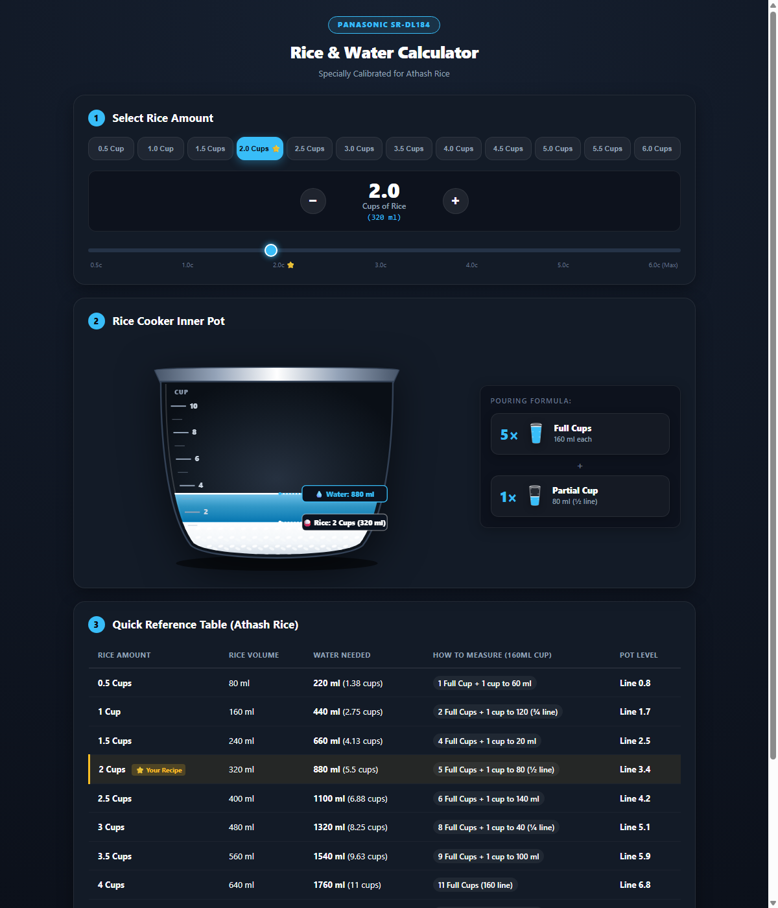

# 🍚 Panasonic SR-DL184 Rice & Water Calculator <br> (Athash Rice Edition) 💧

> **Because life is too short for mushy rice or crunchy surprises.**  
> An ultra-sleek, interactive, physics-powered companion for cooking **Athash Rice (আঠাশ চাল)** in the **Panasonic SR-DL184 10-Cup (1.8L) Microcomputer Rice Cooker**.



> [!IMPORTANT]
> **Specially Calibrated for Athash Rice (BR-28 / আঠাশ চাল)**:  
> Athash is a beloved medium-slender grain known for its thirst! In the Panasonic SR-DL184 Binchotan inner pot, it cooks to perfection with **$5.5$ cups of water ($880\text{ ml}$)** per **2 cups of rice** ($2.75\times$ ratio).
> 
> **Real-World Pot Gauge Calibration**:  
> In the physical pot, filling all the way to **Line 4** takes $6.5$ cups of water ($1.625$ cups of water per line). Therefore, 2 cups of rice with $5.5$ cups of water sits accurately at **Line 3.4** (below Line 4). And to fill the pot all the way to **Line 10 (Pot Max)**, you can cook up to **6.0 cups of rice** ($16.5$ cups water / $2640\text{ ml}$)!

---

## 🌾 The Backstory: Why Does This Exist?

You bought a gorgeous **Panasonic SR-DL184 10-Cup (1.8L)** rice cooker. You grabbed the included **160 ml clear plastic measuring cup**. You set out to cook 2 cups of Athash rice.

You check the cookbook, you check the pot's stamped gauge lines, and suddenly you're doing fractional kitchen calculus at 7:00 PM on a hungry stomach:
- *Wait, 2 cups of Athash rice needs 880 ml of water (5.5 cups)?*
- *How do I measure 5.5 cups of water with a 160ml cup without guessing?*
- *Which line on the pot does it reach? (Line 3.4, below Line 4!)*

**Never do kitchen mental math again.** This mini web app turns Athash rice cooking into a delightfully visual, 60fps physics spectacle!

---

## ✨ Features That Make Cooking Rice Unnecessarily Awesome

### 1. 🌊 Real-Deal Gravity Waterfall Physics
- **Simultaneous Bouquet Pouring**: Need 5 cups of water? It doesn't pour one by one like dial-up internet—it deploys all full cups simultaneously in an arched bouquet across the pot rim!
- **Parabolic Trajectory**: Water doesn't shoot in straight sticks. Liquid accelerates under gravity, leaping out of the tilted cup mouth in a natural curve and plunging vertically into the pool.
- **Dynamic Pour Tilt**: As water drains, the cups dip deeper past horizontal ($\approx 22^\circ \to 98^\circ$) to realistically dump every last drop.
- **Two-Phase Delivery**: Empties all full cups first, then brings out the **Partial Cup** (filled to the exact $40$, $80$, or $120$ ml line) to finish the job!

### 2. 🫗 "Full Cups" + "Partial Cup" Formula
- Minimalist, unbolded cards right beside the pot.
- Instantly tells you:
  $$\mathbf{5\times \text{ Full Cups (160 ml)}} \;+\; \mathbf{1\times \text{ Partial Cup (80 ml / ½ line)}} = \mathbf{880\text{ ml}}$$
- No guessing which mark to hit!

### 3. 🛡️ Anti-Collision Smart HUD Badges
- Cook just $0.5$ or $0.25$ cups of rice? Most apps would let the Water and Rice badges collide into an illegible clump.
- Our intelligent layout engine detects vertical proximity and deploys an angled leader line callout with guaranteed clearance so badges never overlap!

### 4. 🎛️ Modern, Tactile Controls
- **12 One-Click Quick Select Pills** on a single desktop row (`0.5 Cup` to `6.0 Cups`, featuring your starred `2.0 Cups ⭐` recipe).
- **Precision Stepper Buttons** (`−` and `+` in $0.25$-cup increments up to $6.0$ cups).
- **Velvety Smooth Slider** with marked calibration notches up to `6.0c (Max)`.
- **Quick Reference Cheatsheet Table**: Click any row in the table to instantly simulate that recipe!

---

## 🍳 The Athash Rice Golden Ratio Reference

Based on the calibrated Panasonic 10-cup pot ratio ($2.75\times$ water volume to rice volume; $1.625$ cups water per pot gauge line based on real-world test of 6.5 cups water = Line 4):

| Rice (Cups) | Rice Volume | Water Needed | How To Measure (160ml Cup) | Pot Level Line |
|:---:|:---:|:---:|:---|:---:|
| **0.5 Cup** | 80 ml | 220 ml | `1 Full Cup + 1 Partial Cup (60 ml)` | **Line 0.8** |
| **1.0 Cup** | 160 ml | 440 ml | `2 Full Cups + 1 Partial Cup (120 ml / ¾ line)` | **Line 1.7** |
| **1.5 Cups** | 240 ml | 660 ml | `4 Full Cups + 1 Partial Cup (20 ml)` | **Line 2.5** |
| **2.0 Cups ⭐** | 320 ml | 880 ml | `5 Full Cups + 1 Partial Cup (80 ml / ½ line)` | **Line 3.4 (Below Line 4)** |
| **2.5 Cups** | 400 ml | 1100 ml | `6 Full Cups + 1 Partial Cup (140 ml)` | **Line 4.2** |
| **3.0 Cups** | 480 ml | 1320 ml | `8 Full Cups + 1 Partial Cup (40 ml / ¼ line)` | **Line 5.1** |
| **3.5 Cups** | 560 ml | 1540 ml | `9 Full Cups + 1 Partial Cup (100 ml)` | **Line 5.9** |
| **4.0 Cups** | 640 ml | 1760 ml | `11 Full Cups (No Partial Cup!)` | **Line 6.8** |
| **4.5 Cups** | 720 ml | 1980 ml | `12 Full Cups + 1 Partial Cup (60 ml)` | **Line 7.6** |
| **5.0 Cups** | 800 ml | 2200 ml | `13 Full Cups + 1 Partial Cup (120 ml / ¾ line)` | **Line 8.5** |
| **5.5 Cups** | 880 ml | 2420 ml | `15 Full Cups + 1 Partial Cup (20 ml)` | **Line 9.3** |
| **6.0 Cups** | 960 ml | 2640 ml | `16 Full Cups + 1 Partial Cup (80 ml / ½ line)` | **Line 10.2 (Pot Max!)** |

---

## 🚀 How to Run It

This app is zero-bloat vanilla web tech: pure HTML5, modern CSS3, and buttery SVG animations. No bundlers or npm build steps required.

### Option 1: Just Double-Click!
Open [`index.html`](index.html) directly in any modern browser (Chrome, Edge, Firefox, Safari).

### Option 2: Run Local Dev Server
```bash
# Start the lightweight Node server:
npm start

# Or with node directly:
node server.js
```
Then visit [`http://localhost:3000`](http://localhost:3000).

---

## 📱 Mobile Friendly

Grab your phone while standing by the sink! On smaller screens, the pouring formula automatically shifts below the pot side-by-side, giving you a clean, pocket-sized kitchen guide.

---

*Bon Appetit! May your Athash rice always be fluffy, fragrant, and cooked to absolute perfection.* 🍚🥢
